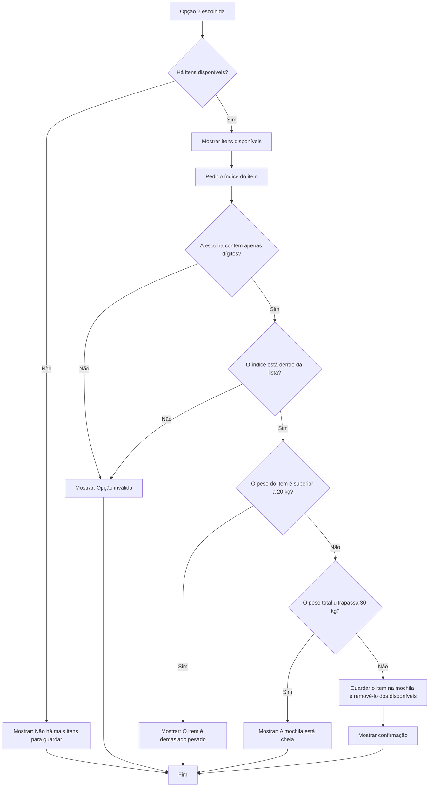

# Mochila do Aventureiro

**Julia Holanda** — 22604731

Um programa em Python para gerir os itens que o aventureiro guarda na mochila, de forma **simples** e *interativa*.

## Como correr

Na pasta do projeto, executa:

```bash
python mochila.py
```

Se o teu sistema usar `python3` para executar Python, podes usar:

```bash
python3 mochila.py
```

## Itens iniciais

| Item | Peso | Peso em binário |
|---|---:|---:|
| Espada | 8 kg | 1000 |
| Escudo | 10 kg | 1010 |
| Poção | 1 kg | 1 |

## Fluxograma


